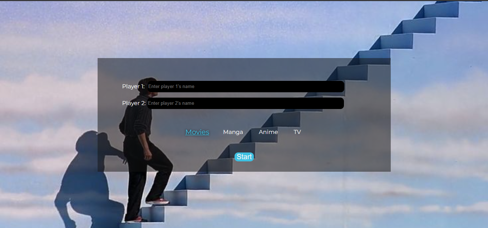
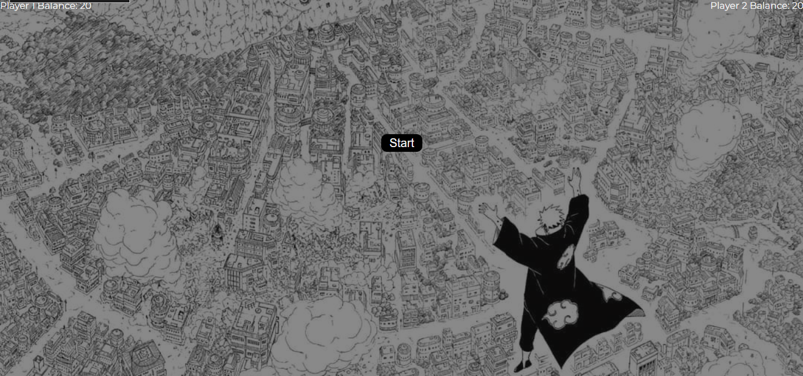
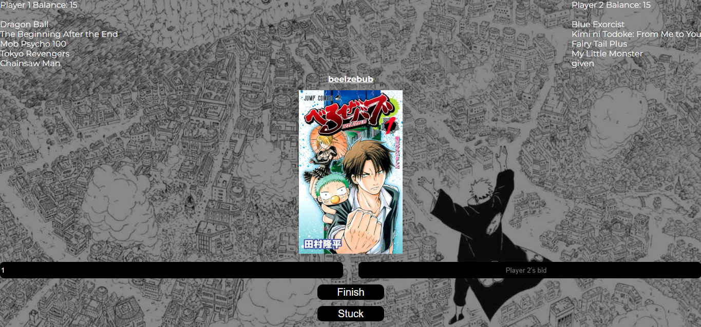
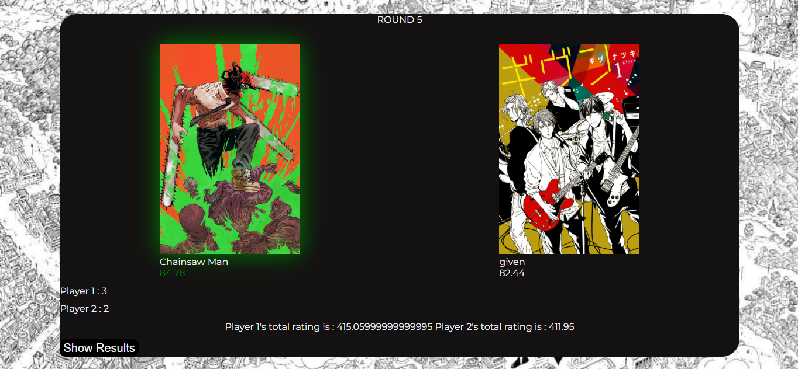
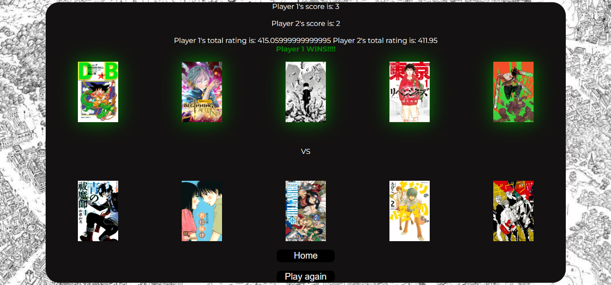

# draft
A website where you draft Movie, Series, Tv series or Manga with allocated money(20$)

**The tools used in making:**
>HTML
>CSS
>JS

**Use case:**
>Fun game for me to play with friends at school

**Working mechanism:**
>You're greeted with this page after opening the website

>You select the mode you want to play and enter players name and click start
>For manga you get this page and for others its similar page with different background

>Click start again

>According to the mode you selected you get a random item like this, both users bid for that item and highest bidder takes it 

>This continues until both have 5 items and if allocated money is insufficient stuck button can be pressed to get 10 extra fund

>After both draw 5 items , finish button pops up to take user to evaluation screen 

>Evaluation takes place on both items 1 on 1 (1st item of player 1 with 1st item of player 2 and so on) and at last winner is decided

>The one on one evaluation 

>Final screen after taking both one on one score and total score into account

**The project can be run at**
https://shimes18.github.io/draft/

**Repo link:**
https://github.com/shimes18/draft

**AI usage:**
>AI was used to help me learn how to handle api (My first project with api)
>Used for full debug a few times (**ONLY WHEN I COULDN'T FIND THE BUG MYSELF**)
>Used to hide api key with secrets (Learned how to do it and then used code from ai , idk how well the api key is hidden)
>Google overview syntaxes

**APIS used in this:**
>TMDB API= For movie , anime and tv draft
>KITSU API = For manga draft

**Difficulties faced:**
>First time using api so clueless at times
>Trying to hide API key

**TV,ANIME AND MANGA DRAFT DIDNT REQUIRE MUCH CHANGE FROM MOVIES SO ALL 3 WERE ADDED IN VERY LESS AMOUNT OF TIME**

some of the files could be redundant but we ballin :3